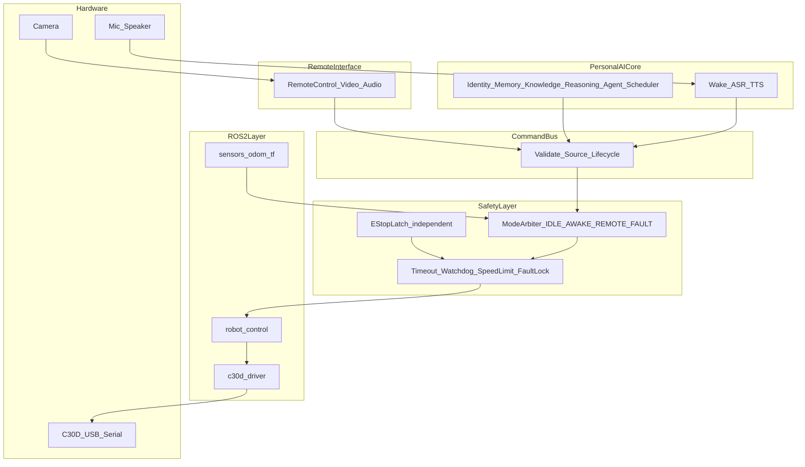

# 系统架构

- 版本：Phase 0 设计
- 日期：2026-10-15
- 约束：全新架构，不复用旧 Pi-Robot 业务代码；旧文档与厂商协议仅作参考并须复验。

## 1. 分层

```
Remote Interface     远程控制、视频、音频
Personal AI Core     身份、记忆、知识、推理、Agent、工具、调度、语音
Command Bus          命令校验、来源、生命周期
Safety Layer         模式互斥、超时、故障锁定、急停锁存（独立于模式）
ROS 2 Layer          驱动、控制、状态、里程计、传感器、导航
Hardware Layer       C30D、相机、麦克风、扬声器、雷达等
Data / Operations    配置、日志、数据、模型、监控
```

硬约束：

- AI 与远程界面不得打开电机串口。
- 运动命令路径只能是：来源 → Command Bus → Safety Layer → `robot_control` → `c30d_driver` → 串口。
- `c30d_driver` 不得扩散 C30D 特有帧到其他包。对外优先标准消息：`geometry_msgs/Twist`、`nav_msgs/Odometry`、`sensor_msgs/*`、TF。

## 2. 模块职责

| 模块 | 职责 | 不做什么 |
|---|---|---|
| `c30d_driver` | 串口发现、组帧/解析、连接恢复、退出时停止策略、发布原始反馈 | 不做模式仲裁、不直接服务 AI |
| `robot_control` | 限速、坐标系、从安全层接收已放行速度 | 不绕过 Safety 发串口 |
| `safety_manager` | 模式、许可、超时、FAULT、急停锁存、唯一向底盘发布许可速度 | 不实现厂商协议细节 |
| Command Bus | 校验、来源（REMOTE/AWAKE/系统）、命令 ID 与取消 | 不直接驱动电机 |
| `robot_bringup` | launch、参数、TF 静态发布 | 无业务逻辑 |
| `sensor_driver` / `perception` / `navigation` | 后期传感器与 Nav2 | Phase 11 前不作为运动源 |
| Personal AI | 唤醒、ASR/TTS、记忆、工具调用 | 运动只走 Command Bus |
| Remote | 会话、视频、音频、遥控输入 | 心跳丢失必须撤销许可 |
| `hardware_test` | 可重复的离线/离地协议测试 | 不得作为 bringup 默认启动项 |

倾向自研 Safety 仲裁，避免与 `twist-mux` 双仲裁。若引入 twist-mux，必须明确它只是 Safety 的实现细节，不能再有第二条 `/cmd_vel` 入口到底盘。

## 3. 数据流



话题与状态机已在 Phase 2A **冻结**，见 `docs/safety_interface.md`。底盘唯一速度入口为 `/cmd_vel_safe`。反馈 `/odom`、`/tf` 仍为 Phase 5。

## 4. 机器人状态机

互斥模式：`IDLE`、`AWAKE`、`REMOTE`、`FAULT`。

同一时刻只有一个模式。`IDLE` 与 `FAULT` 无运动许可。

| 从 | 到 | 进入条件 | 退出时必须 |
|---|---|---|---|
| IDLE | AWAKE | 唤醒成功，且急停未锁 | — |
| IDLE | REMOTE | 远程会话认证成功，且急停未锁 | — |
| AWAKE | IDLE | 退出词或会话超时 | 撤销许可、清空命令、确认不再发速度 |
| REMOTE | IDLE | 断开或主动退出 | 同上 |
| 任意 | FAULT | 串口丢失、协议错误超限、未定义运动、安全检查失败 | 立即走停止策略并锁运动 |
| FAULT | IDLE | 人工确认 + 自检通过，且急停未锁 | 禁止自动恢复后立刻运动 |
| AWAKE | REMOTE | **禁止** | 必须经 IDLE |
| REMOTE | AWAKE | **禁止** | 必须经 IDLE |

优先级（高 → 低）：硬件急停（若存在）> 软件急停锁存 > FAULT > 模式运动许可。

控制权切换协议：

1. `revoke(old)`：停止授权、清空队列、停止向驱动发布非零速度。
2. 等待「安全静止」或进入 FAULT（「安全静止」的判定依赖 Phase 2 停车验证，不得假设零速即停）。
3. `grant(new)`：新来源才可发布。
4. 旧命令不得因 ROS 队列或缓存继续生效。

## 5. 急停（独立机制，不是模式）

| 类型 | 定义 | 当前能力 | 限制 |
|---|---|---|---|
| 软件急停 | 最高优先级锁存，切断运动许可并执行已验证停止策略 | 设计上必须有；策略待 Phase 2 | 依赖串口仍可写 |
| 通信失联保护 | 命令超时、远程心跳丢失 | 走软件急停路径 | 停车效果取决于协议 |
| 硬件急停 | 独立于 Pi 的切断动力或驱动使能 | **未验证，视为不具备** | 不得宣称工业级急停 |

清除急停必须人工操作，禁止超时自动解除。

若仅拔 USB 或杀进程：电机是否滑行、是否保持最后速度，**未知**，列入已知问题。

## 6. 目录约定

- 工程文档：`docs/`（本目录）
- 厂商与旧项目只读资料：`doc/`（不改内容）
- ROS 源码：`ros2_ws/src/`；`build/`、`install/`、`log/` 仅 colcon 生成
- 硬件试验：`hardware_test/`，与正式驱动分离
- 配置 / 数据 / 日志 / 脚本：`config/`、`data/`、`logs/`、`scripts/`
- 遗留实验包（Phase 1）：`archive/legacy_c30d_driver/`

第一批只创建阶段所需路径，不预先铺满空目录。

## 7. 与旧项目的关系

旧 Pi-Robot（`doc/README.md`）提供的可参考经验：IDLE / AWAKE / REMOTE 互斥、语音唤醒超时、远程接入与唤醒互斥。

不可参考为实现的部分：插件直控电机、无 Safety 层、非 ROS2 消息总线、未验证停车逻辑。
