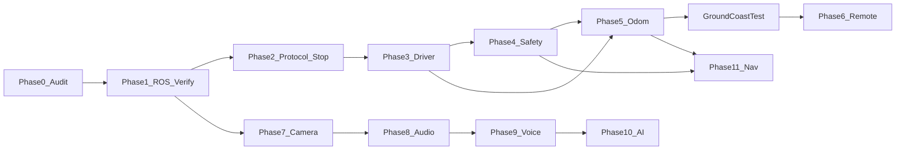

# 开发阶段计划

- 日期：2026-10-15
- 规则：一次只实施一个阶段；完成后等待审核。未经批准不得进入下一阶段。
- 运动测试：默认不转电机。实机运动必须单独书面批准。先静态检查与无电机/轮子离地，再受控实机。

## Phase 0 — 环境审计与总体架构（当前）

- 目标：实测环境、目录建议、架构、阶段验收、风险。
- 依赖：无。
- 实施：只读审计 + 写入 `docs/`。
- 验收：本目录四份文档齐全；用户审核。
- 回退：删除或修订 `docs/` 即可，系统无变更。
- 状态：已关闭。用户已批准并实施 Phase 1。

## Phase 1 — ROS 2 工作空间验证与开发依赖

用户已预选范围：**验证 + pip/venv/p7zip + udev 串口链接 + video/audio 组**。不装 Docker / Nav2 / CycloneDDS。

- 目标：证明 Jazzy/colcon 可用；工作空间卫生；串口稳定设备名；相机/音频组权限。
- 依赖：用户 sudo；批准本阶段。
- 计划：
  1. `source /opt/ros/jazzy/setup.bash`，运行 `ros2 doctor`。
  2. 将遗留 `ros2_ws/src/c30d_driver`（含其内部 build/install/log）移至 `archive/legacy_c30d_driver/`。
  3. 清理或重建工作空间级 `build/install/log`；添加 `.gitignore`。
  4. 可选：初始化 git（另确认；不自动 push）。
  5. apt：`python3-pip`、`python3-venv`、`p7zip-full`。
  6. udev：USB `by-id` → `/dev/c30d`；插拔确认，不发运动帧。
  7. `usermod -aG video,audio andylong`（需重新登录）。
  8. 最小 `ament_python` 包 colcon 构建（无电机）。
- 验收：
  - `ros2 doctor` 无致命错误。
  - 空包/最小包 colcon 成功。
  - 遗留驱动已离开 `ros2_ws/src`。
  - `/dev/c30d` 指向当前 ACM 设备或等价 by-id 路径文档化。
  - `id` 显示 video、audio（重新登录后）。
- 回退：卸载新 apt 包、删除 udev 规则、退组。不卸载 Jazzy Desktop。
- 失败：sudo 失败则停止，不部分应用。
- 状态：**已正式关闭**（`ws_smoke` colcon 通过；`ros2 doctor` 3 项通过）。详见 `docs/phase1_workspace_verify.md`。

## Phase 2 — C30D 协议与安全停止

- 目标：独立验证帧格式、校验、停止行为；明确零速与反向制动效果。
- 依赖：Phase 1；轮子离地或顶起为默认条件。
- 计划：静态对照厂商源码与遗留 `build_frame`；无电机仿真组帧；再经批准做离地串口试验。每个用例必须有步骤、预期、**停止条件**。
- 验收：`docs/` 中有协议说明、停止命令、停止时间或失败记录；禁止把未验证的零速当作急停。
- 回退：停发、关闭串口、记录日志。
- 状态：**已正式关闭**（2026-10-19）。见 `docs/phase2_close.md`。

## Phase 3 — 新 C30D ROS 2 驱动与限速

- 目标：重写 `c30d_driver`（不拷贝遗留节点）；只订阅安全层放行速度；限速；串口断开/异常/退出处理。
- 依赖：Phase 2 协议结论。
- 验收：单元测试覆盖组帧；断开可检测；进程退出执行已验证停止策略；不写死 `ttyACM0`。
- 回退：停止节点，保留 `hardware_test`。
- 状态：**已正式关闭**（2026-10-19）。见 `docs/phase3_close.md`。

## Phase 4 — 安全管理

- 目标：模式互斥、命令超时、FAULT、急停锁存、控制权切换。
- 依赖：Phase 3。
- 验收：REMOTE 与 AWAKE 不能同时有运动权；切换无旧命令；超时触发停止路径；急停需人工清除。
- 回退：关闭 bringup。
- 操作流程：`docs/phase4_safety_plan.md`。**已正式关闭**（2026-10-19）。见 `docs/phase4_close.md`。

## Phase 5 — 编码器、里程计、TF

- 目标：反馈、`/odom`、TF。
- 依赖：Phase 3–4。
- 验收：TF 树完整；不要求导航级精度。
- 回退：关闭里程计发布。
- 流程：`docs/phase5_plan.md`。**已正式关闭**（2026-10-19）。见 `docs/phase5_close.md`。着地补测已通过。

## 着地补测（Phase 5 后、Phase 6 前）

- 目标：着地短距前进、松手停、急停锁存；记录滑行。
- 依赖：Phase 5 关闭。
- 验收：能走能停、急停锁住；**仍不宣称工业级急停。**
- 流程：`docs/ground_coast_test_plan.md`。**已通过**（约 1s、约 15cm 后停下）。仍非工业急停。

## 阶段顺序（已确认调整，2026-10-19）

着地短测之后不再按「先远程网页」：

1. 相机（静图/认设备）  
2. 音频（麦+喇叭通断）  
3. Command Bus + 编号技能（只发 ID；履约在 ROS）+ **LED / 蜂鸣器**（Pi GPIO，引脚须复测）  
4. REMOTE 界面  
5. AWAKE 语音  
6. 雷达/跟随/避障另批  

旧 zip 接口摘录：`docs/legacy_hw_interfaces.md`。未批准前不测 GPIO/相机开流。

## Phase 6 — 远程控制

- 目标：远程会话、状态监控、遥控速度走 Command Bus。
- 依赖：Phase 4。
- 验收：认证；心跳丢失停车；不能直连串口。
- 回退：停远程服务。

## Phase 7 — 摄像头、视频、拍照

- 目标：实时视频与拍照。
- 依赖：Phase 1 组权限；相机复测。
- 验收：流与拍照可用；不影响 Safety。
- 回退：停相机节点。

## Phase 8 — 双向音频

- 目标：对讲。
- 依赖：声卡复测与 audio 组。
- 验收：双向通路；记录延迟。
- 回退：停音频节点。

## Phase 9 — 唤醒、ASR、TTS

- 目标：语音链路。参考旧项目产品流程，不复用其代码。
- 依赖：Phase 8。
- 验收：唤醒只进入 AWAKE；运动仍经 Safety。
- 回退：关语音。

## Phase 10 — Personal AI Core

- 目标：身份、记忆、知识、推理、Agent、工具、调度。
- 依赖：Phase 9。
- 验收：工具与运动只经 Command Bus。
- 回退：关 agent。

## Phase 11 — 雷达、定位、建图、Nav2

- 目标：自主移动。需单独硬件与软件包批准。
- 依赖：Phase 4–5 稳定。
- 验收：另开设计。
- 回退：不启动导航 launch。

## 阶段依赖简图

